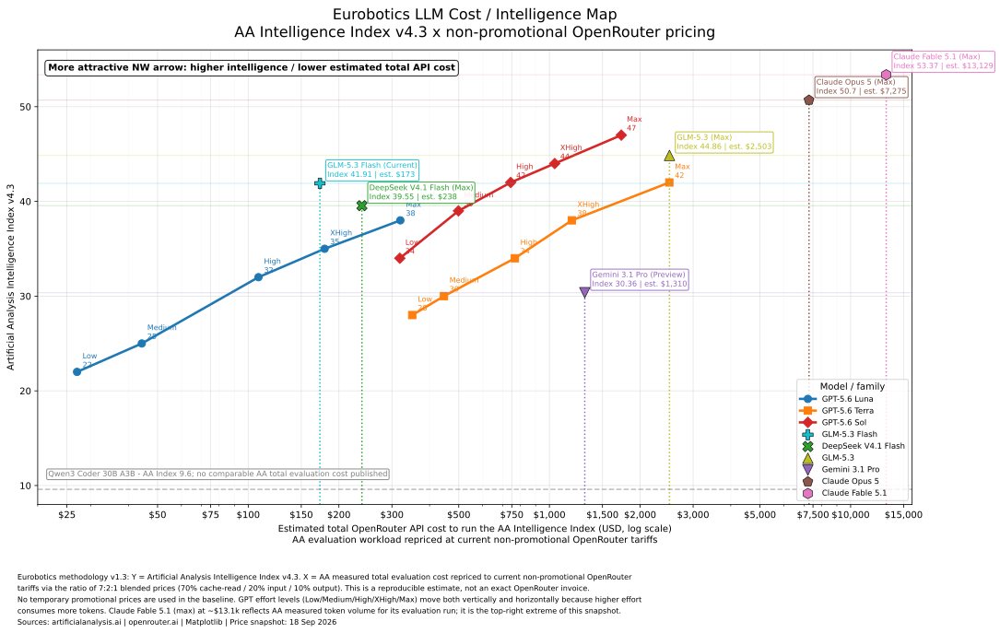

# Eurobotics LLM Cost / Intelligence Map

**Latest chart:** [SVG](charts/latest/llm_cost_performance_latest.svg) · [PNG](charts/latest/llm_cost_performance_latest.png) · [PDF](charts/latest/llm_cost_performance_latest.pdf) · [source data](data/eurobotics_v17_aa_v432_openrouter_nopromo_eurobotics_261024_1608.csv) · [Matplotlib code](src/generate_latest_chart.py)

LLM-Analysis is a public Eurobotics project comparing language models for DevOps, coding agents, autonomous engineering, and AI-assisted operations.

## Methodology v1.7 (24 October 2026)

- **Capability:** Artificial Analysis Intelligence Index v4.3 series. The new GPT-6 points use AA v4.3.2.
- **Cost:** AA's measured total evaluation cost, repriced to non-promotional OpenRouter standard-provider tariffs.
- **Blend:** 70% cache read + 20% uncached input + 10% output. Estimated OpenRouter cost = AA total cost × (OpenRouter blend / AA reference blend).
- **Effort:** GPT-5.6 and GPT-6 variants are plotted as separate effort points, so both intelligence and evaluation cost change along each curve.

The renderer recomputes the blends and estimated costs from the CSV's source tariffs and checks them against its stored derived columns. Provider choices are named in the [price snapshot](docs/methodology.md); this is a selected standard-provider comparison, not the cheapest route across OpenRouter. The chart compares hosted API costs, not the cost of self-hosting open weights.

GPT-6.1 Sol now spans **Index 42.08–51.83 at about $250–$1,082**. Claude Sonnet 5.5, Gemini 4 Argon, Mistral Large 4, and Mistral Small 4 are included from current AA observations. [AA GPT-6.1 Sol](https://artificialanalysis.ai/models/gpt-6-1-sol), [AA Sonnet 5.5](https://artificialanalysis.ai/models/claude-sonnet-5-5), [AA Gemini 4 Argon](https://artificialanalysis.ai/models/gemini-4-argon).

The [24 October price audit](docs/methodology.md) checks every charted model against OpenRouter. GPT-5.6 Sol uses its **$4/$20 undiscounted** tariff despite the 50% offer. GLM-5.3 Flash uses Z.ai's current **$0.15/$0.50** list tariff; the old $0.09/$0.30 rate is promotional today. Every plotted tariff is an undiscounted OpenRouter list tariff. Gemini 4 Argon's $2/$10 headline carries `discount: 0.5`, so the chart uses $4/$20/$0.20; GPT-5.6 Sol remains at its undiscounted $4/$20.

The chart is informational only and must not be used for budgeting. Verify current prices and model capability for your own requirements. Eurobotics.org provides no warranty. [Open an issue](https://github.com/Eurobotics-Association/LLM-Analysis/issues) to request a correction or improvement.

## Reproduce

Run `python src/generate_latest_chart.py` after installing `requirements.txt`. The renderer writes timestamped PNG, PDF, and SVG files in `charts/latest/` and updates the README to link to the newly generated timestamped artifacts.

See [methodology](docs/methodology.md), [data](data/), and [contributor conventions](AGENTS.md).
