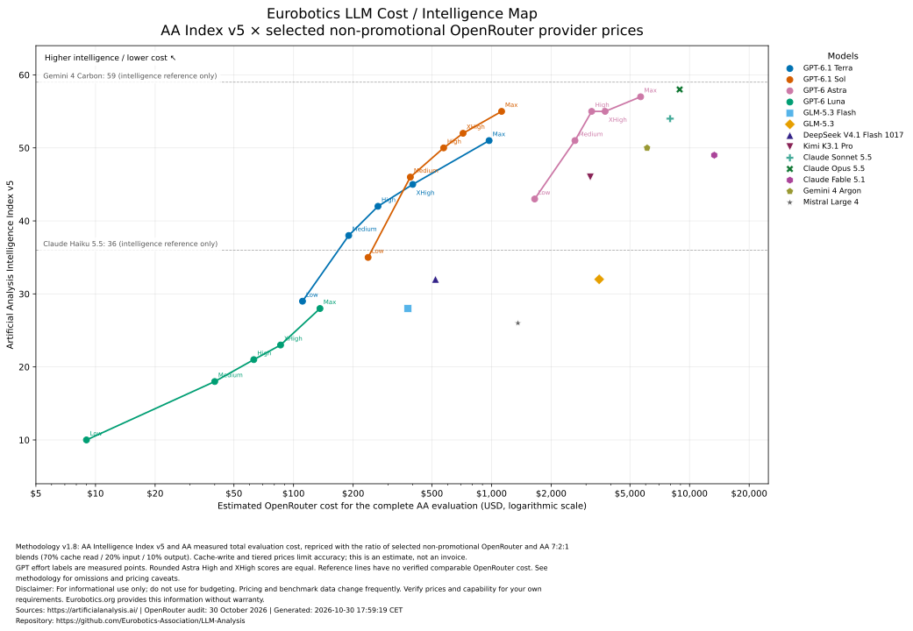

# Eurobotics LLM Cost / Intelligence Map

**Latest chart:** [SVG](charts/latest/llm_cost_performance_latest_eurobotics_261030_1759.svg) · [PNG](charts/latest/llm_cost_performance_latest_eurobotics_261030_1759.png) · [PDF](charts/latest/llm_cost_performance_latest_eurobotics_261030_1759.pdf) · [source data](data/eurobotics_v18_aa_v5_openrouter_nopromo_eurobotics_261030_1759.csv) · [renderer](src/generate_latest_chart.py)

LLM-Analysis compares language models for DevOps, coding agents, autonomous engineering and AI-assisted operations.

## Methodology v1.8 — 30 October 2026

The vertical axis is the Artificial Analysis Intelligence Index v5. The horizontal axis estimates the cost of its complete evaluation at selected **non-promotional OpenRouter provider tariffs**, using the ratio of AA and OpenRouter 70% cache-read / 20% input / 10% output blends. This is an approximation: AA's measured total includes cache writes, and the blend does not. It is not a budget or invoice. See the [methodology](docs/methodology.md) for source, price and coverage limitations.

The update adds GPT-6.1 Terra, Kimi K3.1 Pro, DeepSeek V4.1 Flash 1017 and Claude Opus 5.5; removes the GPT-5.6 curves; and refreshes available comparisons to v5. Gemini 4 Carbon and Claude Haiku 5.5 appear as intelligence-only references while their comparable OpenRouter cost remains unverified. Several older models are omitted where a comparable v5 score or total was not verified; no v4.3 score is carried into v5. Astra High and XHigh have the same rounded published score.

The chart is informational only and must not be used for budgeting. Verify current prices and model capability for your own requirements. Eurobotics.org provides no warranty. [Open an issue](https://github.com/Eurobotics-Association/LLM-Analysis/issues) to request a correction or improvement.

## Reproduce

Install `requirements.txt` and run `python src/generate_latest_chart.py`. The renderer reads the audited CSV, checks repricing, writes timestamped PNG/PDF/SVG files and updates README links to that snapshot. Source data is not refreshed automatically.
