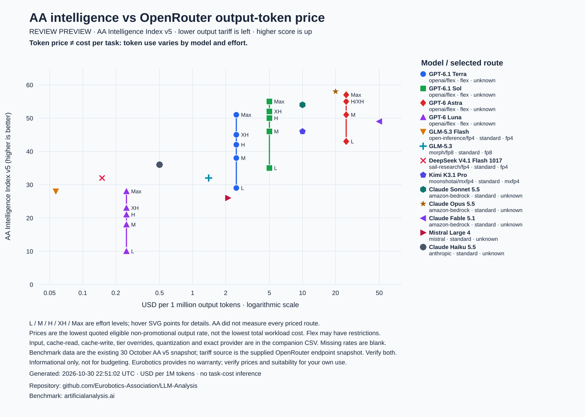

# Eurobotics LLM Intelligence and Token Price Map

This diagram compares Artificial Analysis Intelligence Index scores with OpenRouter output-token prices. Lower prices are on the left and higher scores are at the top. Shapes and colors identify models; labels show reasoning effort.

**Token price is not cost per task.** Models and effort levels can use different amounts of input, output and cached tokens. The scores and prices are a snapshot from **30 October 2026**; the image retains its original “review preview” label. Check current prices and model suitability before making decisions.

[Open the diagram](charts/preview/aa_v5_output_price_preview_eurobotics_261030_2251.svg) · [View input, output and cache rates](data/aa_v5_openrouter_output_rates_eurobotics_261030_2251.csv) · [Read the methodology](docs/token-price-methodology.md) · [Suggest a correction](https://github.com/Eurobotics-Association/LLM-Analysis/issues)

## How to read the diagram

The x-axis shows the lowest quoted eligible non-promotional **output-token** rate in the captured OpenRouter endpoint data, not the cheapest total workload cost. The companion table identifies each selected provider, service tier and quantization, along with the available input and cache rates. Flex routes can have restrictions. Artificial Analysis may have measured a model on a different provider or quantization than the quoted route.

A model’s effort points are vertical because the selected per-token tariff is the same across those settings. Higher effort can still cost more for a task if it consumes more tokens.

## Previous task-cost diagram

The [v1.8 snapshot](charts/latest/llm_cost_performance_latest_eurobotics_261030_1801.svg) and its [source data](data/eurobotics_v18_aa_v5_openrouter_nopromo_eurobotics_261030_1759.csv) are retained for transparency, but their task-cost positions were withdrawn. The existing legacy renderer uses that method and automated rendering remains suspended; the new diagram and prices are not refreshed automatically. See [issue #9](https://github.com/Eurobotics-Association/LLM-Analysis/issues/9) and the [historical methodology](docs/methodology.md).

## Why we changed the methodology

The earlier chart tried to estimate the cost of running the same Artificial Analysis evaluation at OpenRouter prices. It multiplied Artificial Analysis's reported total by a fixed blended-price ratio, but the publicly available data did not provide the actual input, output, cache-read and cache-write quantities needed to reprice each workload reliably. It also used selected providers rather than checking the lowest eligible OpenRouter rates. Those approximations could put models in misleading positions, so the old task-cost chart was withdrawn.

The new diagram compares the Artificial Analysis Intelligence Index with an OpenRouter **output-token tariff**. We show each observed effort level at the same tariff when it uses the same route, and the companion table records input, cache and provider details. This makes the pricing source and unit explicit, but it does **not** tell you the cost of completing a task: token usage, caching, provider behavior and success rates differ. The Artificial Analysis score may also have been measured on a different provider or quantization than the quoted OpenRouter route. See the [methodology](docs/token-price-methodology.md) for the selection rules and limitations.
